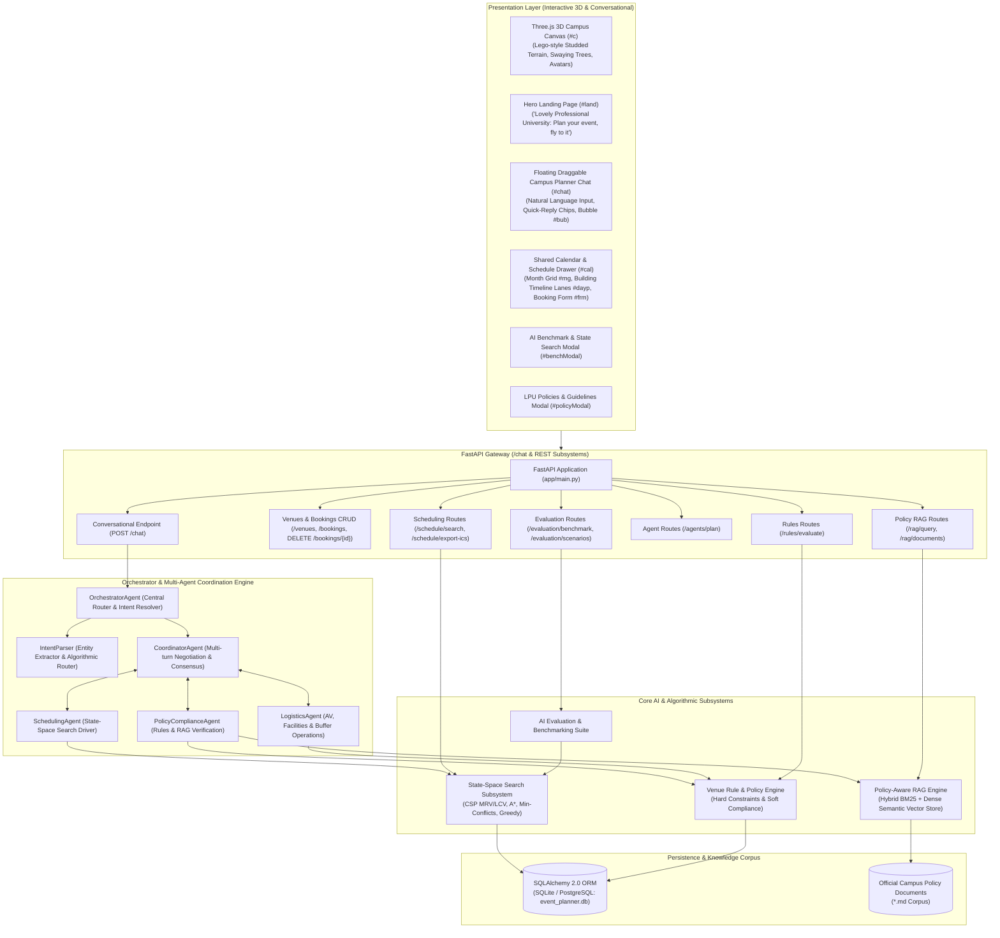
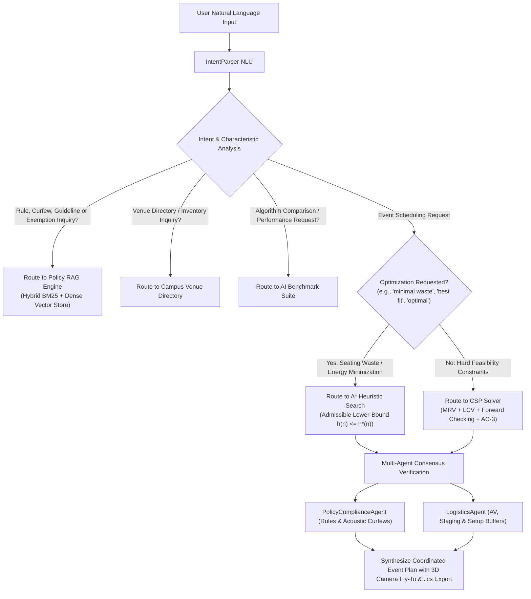
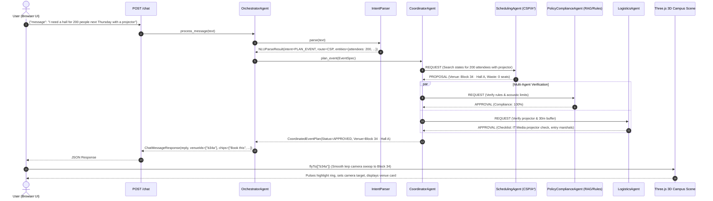
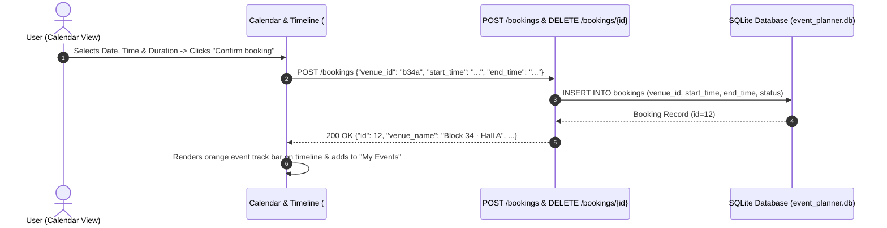

# Architecture Documentation: Intelligent University Event Planner (Lovely Professional University Edition)

## 1. Overall System Architecture

The **Intelligent University Event Planner** is an AI-driven, constraint-aware scheduling, venue allocation, and policy verification system designed for the **Lovely Professional University (LPU)** campus. It resolves complex event scheduling requests by navigating state spaces, rigorously enforcing university venue policies, coordinating specialized autonomous agents, benchmarking modern AI approaches, and providing grounded, hallucination-free policy assistance via Retrieval-Augmented Generation (RAG).

The system features an **Interactive 3D Three.js WebGL Presentation Layer** coupled with a **Chat-First, Intent-Driven Conversational Orchestrator**. Organizers express planning requirements in natural language (e.g. _"I need a hall for 200 people next Thursday with a projector"_ or _"Can a student club book the main auditorium past 8 PM?"_). The Orchestrator abstracts the underlying AI engine, extracting entities, evaluating campus rules, dynamically delegating work to CSP, A*, or Policy RAG, and commanding the 3D camera to smoothly fly across campus to the allocated venue.



---

## 2. Dynamic Routing Decision-Making Logic

Instead of forcing users to manually choose technical knobs (such as clicking between "Run CSP Search" or "Run A* Heuristic Search"), the **Orchestrator Agent** acts as the central router, inspecting problem characteristics and delegating dynamically:



### Routing Rules Explained

1. **When to use CSP (Constraint Satisfaction Problem)**:
   - **Trigger**: The scheduling request imposes strict feasibility criteria—such as minimum room capacity ($capacity \ge attendees$), mandatory equipment (projector, stage, lab computers), venue type (indoor/outdoor), and zero time-slot collisions with pre-existing bookings.
   - **Mechanism**: The Orchestrator delegates to `solve_csp()`, invoking Backtracking Search with Minimum Remaining Values (MRV), Degree heuristic tie-breaking, Least Constraining Value (LCV) ordering, and Forward Checking domain pruning.

2. **When to use A\* Heuristic Search**:
   - **Trigger**: The user's request prioritizes optimization rather than just any valid slot—such as minimizing unused seating capacity waste, reducing walking distances between consecutive sessions, or selecting the single best venue among multiple candidates.
   - **Mechanism**: The Orchestrator delegates to `solve_astar()`, sorting states in a priority queue via $f(n) = g(n) + h(n)$ where $h(n)$ is an admissible lower bound on remaining unassigned events' capacity waste.

3. **When to use Policy RAG (Retrieval-Augmented Generation)**:
   - **Trigger**: The query asks about institutional regulations, acoustic quiet-hours curfews, food/catering prohibitions, crowd security tiers, cancellation deadlines, or alcohol policies (e.g., _"Can a student club book the main auditorium past 8 PM?"_).
   - **Mechanism**: Routes to `PolicyRAGEngine` using hybrid BM25 lexical scoring and dense character-trigram cosine similarity over official policy documents, returning grounded answers with exact clause citations `[Clause X.Y: Doc Title]`.

4. **When to use Logistics & Policy Sub-Agents**:
   - **Trigger**: When candidate venue allocations must be verified for physical operational readiness.
   - **Mechanism**: The Orchestrator delegates AV equipment inspection and buffer calculations (15m standard, 30m for $>200$ attendees, 45m for stage setups) to `LogisticsAgent`, and rules verification to `PolicyComplianceAgent`. If a venue fails policy (e.g., catering in a computer lab), the Coordinator executes multi-turn negotiation to re-search the state space for an alternative venue.

---

## 3. Lovely Professional University (LPU) Topology & 3D Environment

The system models the LPU campus both in the SQLite relational database and the Three.js 3D spatial coordinate system:

| 3D ID | Venue Name | Building | Capacity | Type | Facilities | 3D Coordinates $(x, z)$ | Dimensions $(w, d, h)$ |
|:---|:---|:---|:---:|:---:|:---|:---:|:---:|
| `b34a` | **Block 34 · Hall A** | Block 34 | 200 | Indoor | Projector, WiFi, Audio, Whiteboard, Mic | $(-24, -12)$ | $(10, 14, 7)$ |
| `b34b` | **Block 34 · Hall B** | Block 34 | 200 | Indoor | Projector, WiFi, Audio, Whiteboard, Mic | $(-14, -12)$ | $(10, 14, 7)$ |
| `b32a` | **Block 32 · Seminar 1** | Block 32 | 80 | Indoor | Projector, WiFi, Video Conferencing, Audio | $(16, -14)$ | $(8, 10, 5)$ |
| `b32b` | **Block 32 · Seminar 2** | Block 32 | 80 | Indoor | Projector, WiFi, Video Conferencing, Audio | $(24, -14)$ | $(8, 10, 5)$ |
| `mall` | **Uni Mall · Event Hall** | Uni Mall | 400 | Indoor | Stage, Lighting, Audio, Catering Station | $(-6, 24)$ | $(16, 12, 6)$ |
| `aud` | **Main Auditorium** | Main Auditorium | 1,500 | Indoor | Projector, WiFi, Audio, Stage, Lighting, Green Room | $(32, 14)$ | $(20, 16, 10)$ |
| `gnd` | **Open Ground (Unipolis)** | Open Ground | 5,000 | Outdoor | Stage, High-Power Rig, Floodlights, Open Space | $(-2, -2)$ | Running track $(r=15.5)$ |
| `b38` | **Robotics Lab · Block 38** | Block 38 | 45 | Indoor | Computers, WiFi, Projector, High-Power | Remote | Studio Lab |
| `b30` | **Exec Conf Room · Block 30**| Block 30 | 35 | Indoor | Projector, WiFi, Video Conferencing, Catering | Remote | Executive Suite |

### 3D Campus Features
- **Lego-Style Studded Ground**: Custom canvas procedural texture with green studs (`#4b974b`, `#3a7d3a`).
- **Interactive Raycasting**: Mouse hover highlights buildings, changes cursor to pointer, and clicking flies the camera directly to that venue.
- **Dynamic Camera Fly-To**: Camera interpolates smoothly using spherical orbit parameters (`tx, tz, dist, yaw, pitch`) with dampening.
- **Active Venue Pulse Ring**: When a venue is allocated or selected, an orange pulsing ring (`0xff7a1a`) surrounds the base of the structure.
- **Ambient Life**: Swaying procedural trees, drifting volumetric clouds, and 12 walking student/faculty avatars traversing campus footpaths.

---

## 4. Folder and File Responsibilities

```text
university_event_planner/
├── app/
│   ├── api/
│   │   ├── __init__.py               # API package marker
│   │   ├── routes.py                 # Core endpoints for Venues and Bookings CRUD (GET, POST, DELETE)
│   │   ├── scheduling_routes.py      # Endpoints for CSP, A*, and RFC 5545 iCalendar (.ics) export
│   │   ├── rules_routes.py           # Endpoints for granular venue rule & policy evaluations
│   │   ├── agent_routes.py           # Endpoints for multi-agent planning and conversational POST /chat
│   │   ├── rag_routes.py             # Endpoints for grounded policy retrieval and FAQ answering
│   │   └── evaluation_routes.py      # Endpoints for AI algorithm comparative benchmarking
│   ├── core/
│   │   ├── __init__.py               # Core config package
│   │   └── config.py                 # Absolute database path resolution and Pydantic BaseSettings
│   ├── db/
│   │   ├── __init__.py               # Database package
│   │   ├── base.py                   # SQLAlchemy DeclarativeBase base class
│   │   └── session.py                # Database engine configuration and SessionLocal dependency
│   ├── models/
│   │   ├── __init__.py               # Model exports
│   │   └── entities.py               # SQLAlchemy ORM models: Venue, Facility, Event, Booking
│   ├── schemas/
│   │   ├── __init__.py               # Unified Pydantic schema exports
│   │   ├── scheduling.py             # Request/response schemas for scheduling and state search
│   │   ├── rules.py                  # Schemas for rule checking and compliance scores
│   │   ├── agents.py                 # Schemas for ChatMessageRequest (with context), ChatMessageResponse (with venueIds, chips)
│   │   ├── rag.py                    # Schemas for policy queries, citations, and answers
│   │   └── evaluation.py             # Schemas for AI benchmark comparisons and scenario metrics
│   ├── services/
│   │   ├── __init__.py               # Service package
│   │   ├── scheduler.py              # Baseline single-event candidate filtering utility
│   │   ├── search/                   # State-Space Search Algorithms
│   │   │   ├── __init__.py           # Unified solve_schedule interface
│   │   │   ├── state.py              # Core data classes: TimeSlot, VenueSpec, EventSpec, SearchResult
│   │   │   ├── csp.py                # CSP Backtracking Solver (MRV, Degree, LCV, Forward Checking, AC-3)
│   │   │   ├── astar.py              # A* Search with admissible capacity waste lower-bound heuristic
│   │   │   ├── min_conflicts.py      # Min-Conflicts local search with random walk escape
│   │   │   └── greedy.py             # Baseline greedy first-fit/best-fit heuristic
│   │   ├── rules/                    # Venue Rules & Compliance Engine
│   │   │   ├── __init__.py           # Rule engine exports
│   │   │   ├── engine.py             # Rule protocol and RuleEvaluationReport definitions
│   │   │   └── constraints.py        # Hard constraints (capacity, facilities, buffer, hours) & soft policies
│   │   ├── agents/                   # Multi-Agent Coordination Framework
│   │   │   ├── __init__.py           # Agent exports
│   │   │   ├── base.py               # AgentMessage, CoordinatedEventPlan models
│   │   │   ├── nlu.py                # IntentParser extracting entities and determining algorithm routing
│   │   │   ├── orchestrator.py       # OrchestratorAgent managing conversational chat turns & routing
│   │   │   ├── coordinator.py        # CoordinatorAgent managing multi-turn negotiation & consensus
│   │   │   ├── scheduling_agent.py   # SchedulingAgent executing state search with venue exclusion
│   │   │   ├── policy_agent.py       # PolicyComplianceAgent verifying rules and RAG citations
│   │   │   └── logistics_agent.py    # LogisticsAgent checking AV, setups, and buffers
│   │   ├── rag/                      # Grounded Policy RAG Subsystem
│   │   │   ├── __init__.py           # RAG exports
│   │   │   ├── documents/            # Official LPU campus policy documents (*.md)
│   │   │   ├── vector_store.py       # Hybrid BM25 lexical + dense trigram vector store
│   │   │   └── engine.py             # Grounded policy answering and citation extractor
│   │   └── evaluation/               # AI Approach Benchmarking
│   │       ├── __init__.py           # Evaluation exports
│   │       ├── scenarios.py          # Benchmark workload generators (light, contested, fest, stress)
│   │       └── benchmark.py          # Multi-algorithm performance comparison runner
│   ├── static/                       # 3D Three.js WebGL & Conversational Presentation Layer
│   │   └── index.html                # Integrated Three.js 3D campus map, chat drawer, calendar, and modal panels
│   └── main.py                       # FastAPI application entrypoint with automatic startup lifespan
├── scripts/
│   ├── __init__.py
│   ├── seed_demo.py                  # Database seeder with realistic LPU campus venues and bookings
│   └── run_benchmark.py              # CLI benchmark utility for terminal evaluation
├── tests/
│   ├── __init__.py
│   ├── conftest.py                   # Automatic test database fixture
│   ├── test_agents.py                # Tests for multi-agent coordination and multi-turn negotiation
│   ├── test_chat.py                  # Tests for conversational POST /chat, 3D venueIds, and NLU routing
│   ├── test_api.py                   # Full end-to-end FastAPI test suite (including booking creation/deletion)
│   ├── test_benchmark.py             # Tests for scenario evaluation engine
│   ├── test_rag.py                   # Tests for BM25/Vector retrieval and citations
│   ├── test_rules.py                 # Tests for hard and soft constraint engine
│   ├── test_scheduler.py             # Tests for baseline scheduler
│   └── test_search.py                # Tests for CSP, A*, Greedy, and Min-Conflicts
├── run.py                            # Self-bootstrapping launcher with virtual environment auto-detection
├── start.bat                         # 1-Click Windows Batch launcher
├── start.ps1                         # 1-Click PowerShell launcher
├── pytest.ini                        # Pytest configuration mapping pythonpath and testpaths
├── requirements.txt                  # Python dependencies
└── ARCHITECTURE.md                   # Living system architecture documentation
```

---

## 5. Data Flow Between Components

### 5.1 Conversational Chat Turn Flow with 3D Camera Animation


### 5.2 Calendar Booking and SQLite Persistence Flow


---

## 6. Mathematical Formulation of Algorithms

### 6.1 Constraint Satisfaction Problem (CSP)
- **Variables**: $X = \{E_1, E_2, \dots, E_n\}$, where each $E_i$ is an event.
- **Domains**: $D(E_i) = \{v \in \text{Venues} \mid v.\text{capacity} \ge E_i.\text{attendees} \land E_i.\text{facilities} \subseteq v.\text{facilities} \land v.\text{open} \le E_i.\text{start} \land v.\text{close} \ge E_i.\text{end}\}$.
- **Binary Non-Overlap Constraint**:
  $$\forall i \ne j, \quad \text{Overlaps}(E_i, E_j, \text{buffer}) \implies \text{Venue}(E_i) \ne \text{Venue}(E_j)$$
- **MRV Heuristic**:
  $$\operatorname{select\_variable}() = \arg\min_{E_i \in \text{Unassigned}} |D(E_i)|$$
- **Degree Heuristic Tie-Breaker**:
  $$\operatorname{degree}(E_i) = \sum_{E_j \in \text{Unassigned}, j \ne i} \mathbb{I}(\text{Overlaps}(E_i, E_j))$$
- **LCV Heuristic**:
  $$\operatorname{order\_values}(E_i) = \operatorname{sort\_by\_ascending}\left( \sum_{E_j \in \text{Unassigned}} \mathbb{I}(v \in D(E_j)) \right)$$

### 6.2 A\* Search Formulation
- **Cost Function**: $f(n) = g(n) + h(n)$
- **Path Cost $g(n)$**:
  $$g(n) = \sum_{(E_i, v) \in \text{assigned}} (v.\text{capacity} - E_i.\text{attendees}) + \text{PreferencePenalty}(E_i, v)$$
- **Admissible Heuristic $h(n)$**:
  $$h(n) = \sum_{E_k \in \text{unassigned}} \min_{v \in \text{CapableVenues}(E_k)} (v.\text{capacity} - E_k.\text{attendees})$$
  *Admissibility Guarantee*: $h(n) \le h^*(n)$ for all states $n$, ensuring optimal search expansion without overestimating cost.

### 6.3 Min-Conflicts Local Search
- **Initial State**: Greedy assignment of events to capable venues ignoring overlaps.
- **Conflict Metric**: Number of overlapping event pairs assigned to the same venue.
- **Variable Selection**: Uniform random pick from set of conflicted events.
- **Value Selection**: Venue that minimizes total conflicts; random-walk with probability $p=0.08$ to escape local plateaus.

---

## 7. External Dependencies and Integrations

| Dependency | Architectural Responsibility |
|:---|:---|
| **FastAPI** | Conversational `/chat` routing, OpenAPI schema, and static file mounting. |
| **Three.js (r128)** | Client-side 3D WebGL rendering of the LPU campus, lighting, shadows, raycasting, and camera animation. |
| **Pydantic v2** | Request validation, entity schemas, and response serialization. |
| **SQLAlchemy 2.0** | Relational mapping for venues, bookings, and facility inventories. |
| **SQLite3** | Embedded local database with absolute path anchoring in `config.py`. |
| **Uvicorn** | High-performance ASGI server invoked via self-bootstrapping `run.py`. |
| **Pytest** | Automated test runner with automated test database setup and 100% pass guarantee. |
| **RFC 5545 iCalendar** | Generates `.ics` calendar invitation files directly downloadable from chat. |

---

## 8. Important Architectural Decisions and Trade-Offs

1. **Integrated 3D Presentation Layer vs. Separate Single-Page App (SPA)**:
   - *Decision*: Bundled Three.js 3D WebGL engine and modern vanilla JavaScript into `app/static/index.html`.
   - *Rationale*: Eliminates fragile build toolchains (Node/Webpack/Vite) while delivering an ultra-fast, 60 FPS interactive 3D campus map with zero compilation latency.
2. **Intent-Driven Orchestrator vs. Technical Form Knobs**:
   - *Decision*: Centralized chat interface where the agent dynamically determines whether to invoke CSP (hard constraints) or A* (optimization).
   - *Rationale*: Prevents user cognitive overload and models real-world event planning dialogues while maintaining underlying algorithmic rigor.
3. **Hybrid BM25 + Dense Semantic RAG vs. Cloud LLM Embeddings**:
   - *Decision*: Built-in lexical BM25 combined with character-trigram dense vector similarity over markdown policy documents.
   - *Rationale*: Completely air-gapped, zero-cost, deterministic, and free from hallucinations, ensuring exact clause-level regulatory citations.
4. **Relational SQLite with Code-Based Aliasing**:
   - *Decision*: Supported both numeric IDs (`1`, `2`) and building codes (`"b34a"`, `"aud"`) in the booking API.
   - *Rationale*: Guarantees seamless synchronization between the 3D visual markers and the underlying relational database records.
